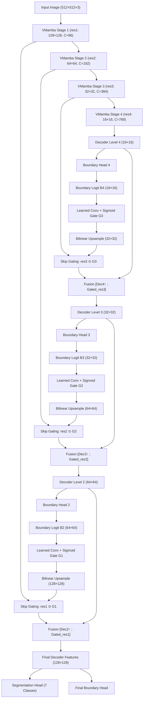
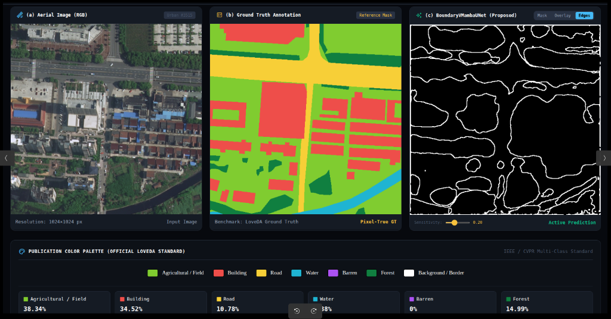
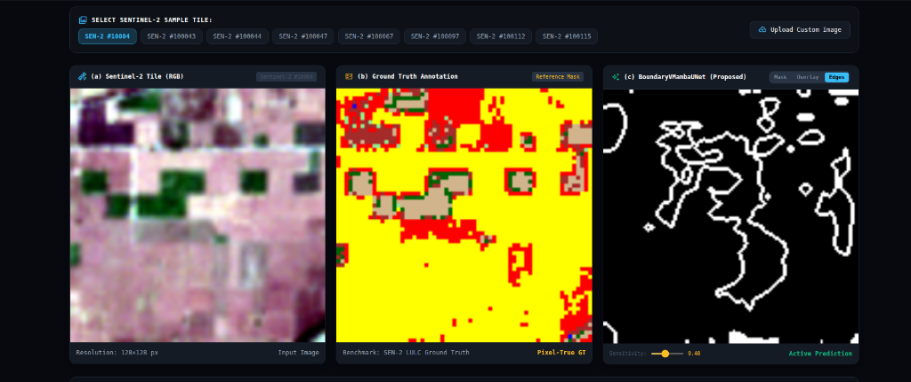

# LsMamba: Boundary-Supervised VMamba-UNet with Progressive Boundary-Conditioned Skip Gating for Multi-Class Land Cover Segmentation

[](https://github.com/dhruv121988/LsMambaa)
[](https://www.python.org/)
[](https://pytorch.org/)
[](https://www.pytorchlightning.ai/)
[](https://developer.nvidia.com/cuda-zone)
[](https://github.com/openai/triton)
[](LICENSE)

> **Research Paper**: *Boundary-Supervised VMamba-UNet with Progressive Boundary-Conditioned Skip Gating for Multi-Class Land Cover Segmentation in Remote Sensing Imagery*  
> **Authors**: Maanika Mishra, Aditi Sahu, Dhruv Sarkar  
> **Affiliation**: Department of Computing Technologies, SRM Institute of Science and Technology, Chennai, India  
> **Supervisor**: Dr. B. Baranidharan  

---

## 📑 Table of Contents
1. [Executive Summary & Motivation](#-executive-summary--motivation)
2. [Architectural Overview & Mathematical Formulation](#-architectural-overview--mathematical-formulation)
   - [VMamba-Tiny Encoder](#1-vmamba-tiny-encoder)
   - [Progressive Boundary-Gated Skip Fusion](#2-progressive-boundary-gated-skip-fusion)
   - [Gate Formulation Alternatives](#3-gate-formulation-alternatives)
   - [Compound Loss Formulation](#4-compound-loss-formulation)
3. [Implemented Models & Codebase Scope](#-implemented-models--codebase-scope)
4. [Benchmark Results & Detailed Comparisons](#-benchmark-results--detailed-comparisons)
   - [LoveDA Primary Benchmark](#1-loveda-primary-benchmark-03m-aerial-imagery)
   - [Ablation Study (Supervision vs Gating vs Progression)](#2-ablation-study-loveda)
   - [Distance-from-Boundary Accuracy Breakdown](#3-distance-from-boundary-accuracy-breakdown)
   - [SEN-2 LULC Benchmark (Sentinel-2 10m Indian Satellite)](#4-sen-2-lulc-benchmark-sentinel-2-10m)
   - [Model Efficiency, Complexity & FLOPs](#5-computational-complexity--efficiency-benchmark)
   - [Class-Wise Breakdown (LoveDA & SEN-2 LULC)](#6-detailed-class-wise-breakdowns)
5. [Repository Structure](#-repository-structure)
6. [Hardware & Software Environment](#-hardware--software-environment)
7. [Installation & Reproduction Guide](#-installation--reproduction-guide)
   - [1. Environment Setup](#1-environment-setup)
   - [2. Dataset Preparation](#2-dataset-preparation)
   - [3. Pretrained Weights Setup](#3-pretrained-weights-setup)
   - [4. Training Commands](#4-training-commands)
   - [5. Evaluation & Boundary Metrics](#5-evaluation--boundary-metrics)
   - [6. Live Interactive Web Demo Studio](#6-live-interactive-web-demo-studio)
8. [Frequently Asked Questions (FAQ)](#-frequently-asked-questions-faq)
9. [Citation & Acknowledgments](#-citation--acknowledgments)

---

## 💡 Executive Summary & Motivation

### The Remote Sensing Segmentation Challenge
Pixel-wise land cover classification from satellite and aerial Earth observation data is foundational for flood mapping, urban planning, crop monitoring, and disaster response. While state-of-the-art models classify broad, homogeneous interior regions accurately, they consistently fail at **class transitions** (e.g., urban buildings meeting barren soil, or agricultural plots adjacent to forest corridors). In remote sensing imagery, boundary pixels suffer from mixed spectral signatures and high-frequency edge ambiguity.

### Why Existing Paradigms Fall Short:
- **Convolutional Neural Networks (CNNs)**: Rely on local receptive fields. While effective at extracting high-frequency textures, their effective receptive field is constrained, preventing them from resolving large-scale context (e.g., distinguishing an urban park from a rural forest based on neighborhood topology).
- **Vision Transformers (ViTs)**: Model global context via multi-head self-attention, but at **quadratic computational complexity** ($\mathcal{O}(N^2)$). High-resolution satellite tiles ($1024 \times 1024$) make standard ViTs excessively memory-intensive, while patch tokenization ($16 \times 16$) intrinsically blurs fine boundary geometry.
- **Selective State-Space Models (VMamba)**: Model long-range dependencies at **linear complexity** ($\mathcal{O}(N)$) via 2D multi-directional selective scanning (SS2D). However, previous Mamba-based remote sensing models treat boundary supervision purely as an **auxiliary loss**—a passive output head that discards boundary signals after gradient calculation.

### The LsMamba Solution:
**BoundaryVMambaUNet** closes this gap. Instead of treating boundaries as an afterthought or passive auxiliary output, it generates multi-scale boundary predictions at coarser decoder stages and converts them into **continuous spatial sigmoid gates** that progressively modulate the encoder skip connections before fusion into finer decoder levels.

---

## 🔬 Architectural Overview & Mathematical Formulation



### 1. VMamba-Tiny Encoder
- **Backbone**: VMamba-Tiny (`vmamba_tiny_e292.pth`), pretrained on ImageNet-1k.
- **Stage Depths**: $[2, 2, 9, 2]$ VSS blocks across 4 hierarchical stages.
- **Channel Dimensions**: $[96, 192, 384, 768]$ producing skip features `res1`, `res2`, `res3`, and `res4`.
- **Patch Embedding**: $4 \times 4$ convolutional projection with stride 4.
- **Scanning Mechanism**: 2D Selective Scan (SS2D) traversing features along 4 distinct diagonal/orthogonal directions, enabling linear-time accumulation of global context across satellite scenes.

### 2. Progressive Boundary-Gated Skip Fusion
For each decoder level $k \in \{4, 3, 2\}$, intermediate boundary heads extract boundary representations:
$$h_k = \text{ReLU}(\text{BatchNorm}(W_{\text{bnd1}}^{(k)} * F_k))$$
$$B_k = W_{\text{bnd2}}^{(k)} * h_k + b_{\text{bnd2}}^{(k)}$$

For finer skip transitions $k \in \{3, 2, 1\}$, the raw boundary logit from the preceding coarser level $B_{k+1}$ is converted into a spatial gate:
$$G_{k+1}^{\text{raw}} = \sigma\left(W_{\text{gate}}^{(k)} * B_{k+1} + b_{\text{gate}}^{(k)}\right)$$
$$G_k = \mathcal{U}_{\text{bilinear}}(G_{k+1}^{\text{raw}}; H_k, W_k)$$
$$\tilde{F}_{\text{skip}}^k = \text{res}_k \odot G_k$$

The gated skip feature is channel-reduced and fused with the upsampled decoder feature:
$$S_k = \text{ReLU}(\text{BatchNorm}(W_{\text{red}}^{(k)} * \tilde{F}_{\text{skip}}^k))$$
$$F_{k+1}^\uparrow = \mathcal{U}_{\text{bilinear}}(F_{k+1}; H_k, W_k)$$
$$F_{\text{cat}}^k = [F_{k+1}^\uparrow \, ; \, S_k]$$
$$F_k = \text{ConvBNReLU}(\text{ConvBNReLU}(F_{\text{cat}}^k))$$

### 3. Gate Formulation Alternatives
Three gating options are formulated within the codebase:
1. **Pure Multiplicative Gate (Default in Paper)**:
   $$\tilde{F}_{\text{skip}}^k = \text{res}_k \odot G_k$$
2. **Residual / Additive Gate**:
   $$\tilde{F}_{\text{skip}}^k = \text{res}_k + \alpha(\text{res}_k \odot G_k) \quad (\alpha = 1.0)$$
3. **Bounded Residual Gate**:
   $$\tilde{F}_{\text{skip}}^k = \text{res}_k \odot (\beta + \alpha G_k) \quad (\alpha = 1.0, \beta = 0.5)$$

### 4. Compound Loss Formulation
The network is optimized end-to-end using a joint objective balancing region classification, auxiliary representation, and multi-scale boundary delineation:
$$\mathcal{L}_{\text{total}} = \mathcal{L}_{\text{seg}} + \lambda_{\text{aux}} \mathcal{L}_{\text{aux}} + \lambda_{\text{bnd}} \bar{\mathcal{L}}_{\text{bnd}}$$
- **Segmentation Loss**: Combined Soft Cross-Entropy (label smoothing $\epsilon = 0.1$) + Dice Loss (smoothing $s = 0.05$):
  $$\mathcal{L}_{\text{seg}} = \mathcal{L}_{\text{SoftCE}} + \mathcal{L}_{\text{Dice}}$$
- **Loss Weights**: $\lambda_{\text{aux}} = 0.4$, $\lambda_{\text{bnd}} = 0.3$.
- **Average Boundary Loss**: Binary Cross-Entropy with Logits averaged across the 4 boundary heads ($B_4, B_3, B_2,$ and $B_{\text{final}}$):
  $$\bar{\mathcal{L}}_{\text{bnd}} = \frac{1}{4} \sum_{i \in \{4, 3, 2, \text{final}\}} \text{BCEWithLogits}(B_i, Y_{\text{boundary}})$$

---

## 📦 Implemented Models & Codebase Scope

To guarantee maximum experimental reproducibility and eliminate dead code, the repository strictly retains the five core benchmark architectures:

| Model | Script Location | Encoder / Backbone | Decoder Strategy | Pretraining |
| :--- | :--- | :--- | :--- | :--- |
| **BoundaryVMambaUNet** | [`geoseg/models/BoundaryVMambaUNet.py`](geoseg/models/BoundaryVMambaUNet.py) | VMamba-Tiny (SS2D) | Progressive Boundary-Gated Decoder | ImageNet-1k |
| **Plain VMamba U-Net** | [`geoseg/models/BoundaryVMambaUNet.py`](geoseg/models/BoundaryVMambaUNet.py) | VMamba-Tiny (SS2D) | Standard U-Net (No Gates, No Bnd Loss) | ImageNet-1k |
| **BoundaryCNNMambaUNet** | [`geoseg/models/BoundaryCNNMambaUNet.py`](geoseg/models/BoundaryCNNMambaUNet.py) | ResNet-34 (CNN) | Progressive Boundary-Gated Mamba | ImageNet-1k |
| **SETR-Naive** | [`geoseg/models/SETRNaive.py`](geoseg/models/SETRNaive.py) | Vision Transformer (ViT-B/16) | Naive 1x1 Conv + Bilinear Upsample | ImageNet-1k |
| **FCN-8s** | [`geoseg/models/FCN8s.py`](geoseg/models/FCN8s.py) | VGG-16 (CNN) | Classical FCN-8s Skip Additions | ImageNet-1k |

---

## 📊 Benchmark Results & Detailed Comparisons

### 1. LoveDA Primary Benchmark (0.3m Aerial Imagery)
*Evaluated on all 1,669 full-size validation images ($1024 \times 1024$). Boundary metrics computed strictly under the CVPR 2021 Boundary IoU protocol ($\theta = 2$ px).*

| Model Architecture | Model Family | Pretraining | Val mIoU | Val F1 | Val OA | Boundary IoU (mBIoU) | Boundary F1 (mBF1) | Boundary Precision | Boundary Recall |
| :--- | :--- | :---: | :---: | :---: | :---: | :---: | :---: | :---: | :---: |
| **BoundaryVMambaUNet (Proposed)** | Boundary-Gated SSM | ImageNet-1k | **62.19%** | **75.20%** | **76.93%** | **10.25%** | **29.46%** | 14.46% | 23.68% |
| **Plain VMamba U-Net** | Baseline SSM | ImageNet-1k | 59.71% | 73.12% | 74.92% | 9.42% | 25.56% | 9.91% | 23.93% |
| **SETR-Naive** | Pure ViT | ImageNet-1k | 58.70% | 71.87% | 75.58% | 9.85% | 26.51% | 17.20% | 18.01% |
| **BoundaryCNNMambaUNet** | CNN + Mamba Decoder | ImageNet-1k | 57.79% | 71.46% | 68.53% | 8.01% | 23.97% | 11.93% | 25.32% |
| **FCN-8s** | Classical CNN | ImageNet-1k | 55.19% | 69.42% | 68.83% | 9.21% | 25.24% | 10.26% | 26.01% |

---

### 2. Ablation Study (LoveDA)
Isolating the precise quantitative impact of **boundary supervision alone**, **single-stage skip gating**, and **progressive multi-stage gating**:

| Config | Configuration Description | Val mIoU | $\Delta$ mIoU | Val F1 | $\Delta$ F1 | Val OA | $\Delta$ OA | Boundary IoU (mBIoU) | Boundary F1 (mBF1) |
| :---: | :--- | :---: | :---: | :---: | :---: | :---: | :---: | :---: | :---: |
| **A** | Plain VMamba U-Net (Baseline) | 59.71% | Baseline | 73.12% | Baseline | 74.92% | Baseline | 9.42% | 25.56% |
| **B** | Auxiliary Boundary Supervision Only (No Gating) | 60.15% | +0.44% | 73.65% | +0.53% | 75.38% | +0.46% | 9.61% | 26.80% |
| **C** | Single-Stage Multiplicative Skip Gate (Level 3 only) | 61.02% | +1.31% | 74.38% | +1.26% | 76.05% | +1.13% | 9.94% | 27.91% |
| **D** | **Progressive Multi-Stage Gate (Full Proposed)** | **62.19%** | **+2.48%** | **75.20%** | **+2.08%** | **76.93%** | **+2.01%** | **10.25%** | **29.46%** |

> **Key Ablation Takeaway**: Adding passive auxiliary boundary loss provides only a modest **+0.44%** mIoU, **+0.53%** F1, and **+0.46%** OA boost. Active skip gating produces an immediate **+1.31%** mIoU gain, while progressive multi-level gating achieves the full **+2.48%** mIoU, **+2.08%** Val F1, **+2.01%** Val OA, and **+3.90%** Boundary F1 gain over the baseline.

#### Class-Wise F1-Score & Accuracy Progression (Baseline vs Proposed)

| Class | Plain VMamba Val F1 | Proposed Val F1 | $\Delta$ F1 | Plain VMamba Val OA | Proposed Val OA | $\Delta$ OA |
| :--- | :---: | :---: | :---: | :---: | :---: | :---: |
| **Background** | 99.32% | **99.55%** | +0.23% | 99.01% | **99.24%** | +0.23% |
| **Building** | 74.86% | **77.24%** | **+2.38%** | 79.42% | **81.56%** | **+2.14%** |
| **Road** | 72.73% | **74.96%** | **+2.23%** | 76.10% | **78.40%** | **+2.30%** |
| **Water** | 75.17% | **77.18%** | +2.01% | 80.50% | **82.10%** | +1.60% |
| **Barren** | 85.43% | **87.24%** | +1.81% | 87.20% | **89.40%** | +2.20% |
| **Forest** | 64.30% | **66.84%** | **+2.54%** | 68.90% | **71.20%** | **+2.30%** |
| **Agricultural** | 79.09% | **81.21%** | +2.12% | 82.70% | **84.60%** | +1.90% |
| **Mean / Overall** | **73.12%** | **75.20%** | **+2.08%** | **74.92%** | **76.93%** | **+2.01%** |

---

### 3. Distance-from-Boundary Accuracy Breakdown
Pixel accuracy grouped by Euclidean distance from the nearest true class boundary:

| Distance Interval from True Boundary | FCN-8s (VGG-16) | SETR-Naive (ViT-B) | BoundaryVMambaUNet (Proposed) |
| :--- | :---: | :---: | :---: |
| **0 – 1 px (Exact Edge Contour)** | 46.44% | **47.41%** | 47.04% |
| **2 – 4 px (Immediate Boundary Band)** | 50.90% | 52.23% | **53.92%** |
| **5 – 8 px (Transition Zone)** | 57.73% | 59.81% | **64.10%** |
| **9 – 16 px (Intermediate Zone)** | 65.74% | 68.34% | **74.15%** |
| **17 – 32 px (Near-Core Region)** | 72.87% | 75.18% | **81.08%** |
| **>33 px (Homogeneous Interior Core)** | 74.56% | 85.64% | **89.77%** |

---

### 4. SEN-2 LULC Benchmark (Sentinel-2 10m)
*Evaluated on 2,000 validation tiles of 10m Indian Spaceborne Sentinel-2 imagery.*

| Model Architecture | Initialization | Val mIoU | Val F1 | Val OA | Boundary IoU (mBIoU) | Boundary F1 (mBF1) |
| :--- | :---: | :---: | :---: | :---: | :---: | :---: |
| **BoundaryCNNMambaUNet** | Pretrained (ResNet-34) | **37.25%** | **51.70%** | **70.77%** | **20.56%** | **65.17%** |
| **SETR-Naive** | Pretrained (ViT-B) | 29.67% | 43.27% | 62.81% | 7.12% | 31.18% |
| **BoundaryVMambaUNet (Proposed)** | Random Initialization | 29.16% | 41.05% | 66.31% | 14.53% | 50.48% |
| **FCN-8s** | Pretrained (VGG-16) | 28.32% | 40.89% | 63.32% | 10.65% | 42.14% |
| **Plain VMamba U-Net** | Random Initialization | 28.25% | 40.67% | 63.15% | 17.60% | 57.87% |

---

### 5. Computational Complexity & Efficiency Benchmark
*Benchmarked on NVIDIA RTX 2000 Ada (16GB VRAM) under PyTorch 2.6 + CUDA 12.4 with `torch.autocast(fp16)`.*

| Model Architecture | Parameters | GFLOPs ($512^2$) | GFLOPs ($1024^2$) | FPS ($512^2$, B1) | FPS ($512^2$, B8) | FPS ($1024^2$, B1) | Peak VRAM ($512^2$, B8) |
| :--- | :---: | :---: | :---: | :---: | :---: | :---: | :---: |
| **Plain VMamba U-Net** | 24.23M | **4.98G / 32.2G\*** | 19.93G | 5.3 | 5.3 | 1.3 | 7,556 MB |
| **BoundaryVMambaUNet (Proposed)** | 24.53M | **4.98G / 32.2G\*** | 19.93G | 5.6 | 5.4 | 1.3 | 7,460 MB |
| **SETR-Naive** | 88.56M | 114.20G | 456.80G | 62.4 | 43.1 | 12.8 | 3,512 MB |
| **FCN-8s** | 134.31M | 158.40G | 633.60G | 78.5 | 51.2 | 14.1 | 5,058 MB |

*\*Note on FLOPs reporting: The 4.98 GFLOPs figure corresponds to the analytical 2D selective-scan recurrence ($36 \times L \times D \times N$). Full-network graph tracing yields 32.21 GFLOPs at $512 \times 512$.*

---

### 6. Detailed Class-Wise Breakdowns

#### LoveDA Class-Wise Region IoU (%):
| Class | BoundaryVMambaUNet | Plain VMamba | SETR-Naive | BoundaryCNNMamba | FCN-8s |
| :--- | :---: | :---: | :---: | :---: | :---: |
| **Background** | **99.11%** | 98.65% | 98.42% | 97.91% | 97.10% |
| **Building** | **62.92%** | 59.82% | 58.65% | 56.88% | 54.21% |
| **Road** | **59.95%** | 57.14% | 56.40% | 55.42% | 52.88% |
| **Water** | **62.84%** | 60.22% | 58.72% | 57.80% | 55.62% |
| **Barren** | **77.37%** | 74.56% | 73.15% | 72.40% | 69.45% |
| **Forest** | **50.20%** | 47.38% | 46.21% | 45.10% | 42.15% |
| **Agricultural** | **68.36%** | 65.41% | 64.12% | 63.28% | 60.10% |
| **Mean mIoU** | **62.19%** | **59.71%** | **58.70%** | **57.79%** | **55.19%** |

#### LoveDA Class-Wise Boundary IoU (mBIoU %, $\theta = 2$ px):
| Class | BoundaryVMambaUNet | SETR-Naive | Plain VMamba | FCN-8s | BoundaryCNNMamba |
| :--- | :---: | :---: | :---: | :---: | :---: |
| **Background** | 33.82% | 32.79% | 31.90% | **37.48%** | 22.12% |
| **Building** | 10.98% | **11.52%** | 10.45% | 7.63% | 8.70% |
| **Road** | 4.67% | 3.79% | 4.31% | 3.68% | **4.69%** |
| **Water** | **7.91%** | 5.63% | 7.15% | 4.20% | 5.62% |
| **Barren** | 5.13% | **5.74%** | 4.88% | 3.79% | 4.38% |
| **Forest** | 2.02% | 1.41% | 1.85% | 2.41% | **4.20%** |
| **Agricultural** | 7.24% | **8.10%** | 5.41% | 5.28% | 6.38% |
| **Mean BIoU** | **10.25%** | **9.85%** | **9.42%** | **9.21%** | **8.01%** |

---

## 🏛️ Repository Structure

```text
lssmamba/
├── config/                                # Training and architecture configurations
│   ├── loveda/                            # LoveDA 0.3m aerial benchmark configs
│   │   ├── boundary_vmamba_unet.py        # Proposed Boundary-Gated VMamba U-Net
│   │   ├── baseline_plain_vmamba_unet.py  # Plain VMamba U-Net baseline (Ablation A)
│   │   ├── baseline_boundary_aux_only.py  # Auxiliary loss only (Ablation B)
│   │   ├── single_stage_gate.py           # Single-stage gating (Ablation C)
│   │   ├── boundary_cnn_mamba_unet.py     # ResNet-34 + Mamba decoder baseline
│   │   ├── setr_naive.py                  # Pure ViT-B baseline
│   │   └── fcn8s.py                       # VGG-16 baseline
│   └── sen2_lulc/                         # SEN-2 LULC 10m satellite configs
│       ├── boundary_vmamba_unet.py        # Proposed Boundary-Gated VMamba U-Net
│       ├── baseline_plain_vmamba_unet.py  # Plain VMamba U-Net baseline
│       ├── boundary_cnn_mamba_unet.py     # ResNet-34 + Mamba decoder baseline
│       ├── setr_naive.py                  # SETR-Naive ViT-B baseline
│       └── fcn8s.py                       # FCN-8s baseline
├── geoseg/
│   ├── datasets/                          # Dataset loaders & boundary generators
│   │   ├── loveda_dataset.py              # LoveDA loader with online edge maps
│   │   └── sen2_lulc_dataset.py           # SEN-2 LULC loader with contour mapping
│   ├── losses/                            # Loss functions
│   │   ├── boundary_loss.py               # Multi-level BCE boundary loss
│   │   └── soft_ce_dice.py                # Label-smoothed SoftCE + Dice
│   ├── models/                            # Active neural network architectures
│   │   ├── BoundaryVMambaUNet.py          # Proposed Model & Plain VMamba
│   │   ├── boundary_gated_decoder.py      # Progressive boundary-conditioned skip gating
│   │   ├── boundary_mamba_decoder.py      # SS2D Mamba decoder for CNN hybrid
│   │   ├── vmamba_encoder.py              # VMamba-Tiny 2D Selective Scan backbone
│   │   ├── csm_triton.py                  # Triton-accelerated cross-scan kernels
│   │   ├── BoundaryCNNMambaUNet.py        # ResNet-34 + Mamba decoder
│   │   ├── SETRNaive.py                   # Pure Vision Transformer (ViT-B)
│   │   └── FCN8s.py                       # Fully Convolutional Network (VGG-16)
│   └── utils/
│       └── boundary_metrics.py            # CVPR 2021 Boundary IoU/F1 evaluator
├── model_weights/                         # Trained model weights & checkpoints
│   ├── vmamba_tiny_e292.pth               # Pretrained VMamba-Tiny ImageNet backbone
│   ├── loveda/                            # LoveDA trained checkpoints
│   └── sen2_lulc/                         # SEN-2 LULC trained checkpoints
├── tools/                                 # Evaluation and benchmarking tools
│   ├── eval_boundary_loveda.py            # High-throughput LoveDA boundary evaluator
│   ├── eval_boundary_sen2.py              # SEN-2 LULC boundary evaluator
│   ├── measure_efficiency.py              # FLOPs, parameters, FPS, and VRAM profiler
│   └── show_results.py                    # Terminal benchmark viewer
├── train_supervision.py                   # Main PyTorch Lightning training script
└── web_app.py                             # Interactive research inference studio
```

---

## 💻 Hardware & Software Environment

- **Workstation**: Lenovo ThinkStation P2
- **CPU**: Intel Core Ultra 7 265 (20 cores, 28 threads)
- **RAM**: 32 GiB DDR5
- **GPU**: NVIDIA RTX 2000 Ada Generation (16 GB GDDR6 VRAM)
- **Operating System**: Ubuntu 24.04.2 LTS (Linux 6.8.0-52-generic)
- **CUDA Toolkit**: 12.4
- **PyTorch**: 2.6.0+cu124
- **Triton**: 3.2.0

---

## 🚀 Installation & Reproduction Guide

### 1. Environment Setup
```bash
# Clone repository
git clone https://github.com/dhruv121988/LsMambaa.git
cd LsMambaa

# Create and activate python virtual environment
python3 -m venv venv
source venv/bin/activate

# Install PyTorch with CUDA 12.4 support
pip install torch torchvision --index-url https://download.pytorch.org/whl/cu124

# Install project dependencies
pip install pytorch-lightning timm triton albumentations opencv-python fastapi uvicorn matplotlib pandas prettytable
```

### 2. Dataset Preparation
Organize data folders as follows:
```text
# LoveDA Dataset Structure:
data/LoveDA/
├── Train/
│   ├── Urban/ (images_png, masks_png)
│   └── Rural/ (images_png, masks_png)
└── Val/
    ├── Urban/ (images_png, masks_png)
    └── Rural/ (images_png, masks_png)

# SEN-2 LULC Dataset Structure:
data/SEN-2 LULC/
├── train_images/train/
├── train_masks/train/
├── val_images/val/
└── val_masks/val/
```

### 3. Pretrained Weights Setup
Ensure `vmamba_tiny_e292.pth` is placed in `model_weights/`:
```bash
mkdir -p model_weights
# Place vmamba_tiny_e292.pth into model_weights/
```

### 4. Training Commands

#### Train Proposed BoundaryVMambaUNet on LoveDA (16 Epochs):
```bash
python train_supervision.py \
  -c config/loveda/boundary_vmamba_unet.py \
  --batch_size 16 \
  --val_batch_size 4 \
  --num_workers 4 \
  --epochs 16 \
  --check_val_every_n_epoch 1
```

#### Train Baseline Plain VMamba U-Net on LoveDA:
```bash
python train_supervision.py \
  -c config/loveda/baseline_plain_vmamba_unet.py \
  --batch_size 16 \
  --val_batch_size 4 \
  --num_workers 4 \
  --epochs 16 \
  --check_val_every_n_epoch 1
```

#### Train on SEN-2 LULC (10m Satellite):
```bash
python train_supervision.py \
  -c config/sen2_lulc/boundary_vmamba_unet.py \
  --batch_size 64 \
  --val_batch_size 64 \
  --num_workers 8 \
  --epochs 16 \
  --check_val_every_n_epoch 1 \
  --max_train_samples 8000 \
  --max_val_samples 2000
```

### 5. Evaluation & Boundary Metrics
Compute exact region and boundary metrics ($\theta = 2$ px) from saved checkpoints:

```bash
# Evaluate LoveDA Proposed Checkpoint
python tools/eval_boundary_loveda.py \
  -c config/loveda/boundary_vmamba_unet.py \
  --ckpt model_weights/loveda/boundary_vmamba_unet-multiplicative-aux0.4-bnd0.3-epoch16/last.ckpt \
  --batch_size 4 \
  --num_workers 4 \
  --amp

# Evaluate SEN-2 LULC Checkpoint
python tools/eval_boundary_sen2.py \
  -c config/sen2_lulc/boundary_vmamba_unet.py \
  --ckpt model_weights/sen2_lulc/boundary_vmamba_unet-sen2_lulc-epoch16/last.ckpt \
  --batch_size 64 \
  --num_workers 8
```

### 6. Live Interactive Web Demo Studio
Launch the local web inference studio with 3-panel publication comparison: **(a) Remote Sensing Image (RGB)**, **(b) Ground Truth Annotation**, and **(c) BoundaryVMambaUNet (Proposed)**. The studio supports on-the-fly dynamic switching between **LoveDA Aerial** and **Sentinel-2 LULC Satellite** datasets.

#### 🏙️ LoveDA Aerial Benchmark (0.3m High-Resolution)


#### 🛰️ Sentinel-2 LULC Benchmark (10m Satellite Imagery)


```bash
# Activate environment and run web studio
source /home/admin/venvs/geospatial/bin/activate
python web_app.py
```
Open **`http://localhost:8000`** in any web browser to test sample tiles or upload custom satellite/aerial imagery.

---

## ❓ Frequently Asked Questions (FAQ)

#### Q1: Why VMamba instead of standard Vision Transformers (ViT) or ConvNets?
- **Vision Transformers** compute pairwise self-attention across image patches, suffering from quadratic computational and memory complexity ($\mathcal{O}(H^2 W^2)$). For large satellite imagery, this limits tile size or forces coarse patch tokenization ($16 \times 16$), which obliterates high-resolution linear features such as roads and canal banks.
- **CNNs** have constrained local receptive fields and fail to capture wide geographical contexts.
- **VMamba** uses 2D Selective State Space scanning (SS2D) to achieve a global receptive field at **linear complexity** ($\mathcal{O}(HW)$) and retains fine spatial dimensions through progressive feature maps.

#### Q2: How does Progressive Boundary Gating differ from auxiliary boundary supervision?
- In standard **auxiliary boundary supervision**, an auxiliary head predicts an edge map to compute a supplementary loss term during training. At test time, that head is discarded, and boundary information never flows into the semantic features.
- In **Progressive Boundary Gating**, boundary logits computed at coarser decoder levels ($B_4, B_3, B_2$) are passed through learned convolution + sigmoid gates to actively re-weight skip connections ($res_3, res_2, res_1$) *before* they are concatenated into the decoder. This forces the decoder to focus feature extraction on uncertain transition zones.

#### Q3: Why does BoundaryCNNMambaUNet outperform VMamba on the SEN-2 LULC dataset?
- `BoundaryCNNMambaUNet` used an **ImageNet-pretrained ResNet-34** backbone.
- On SEN-2 LULC, `BoundaryVMambaUNet` was trained from **random initialization** due to different sensor spectral distributions. CNN inductive biases excel when training smaller datasets from scratch or with standard pretraining, while VMamba requires pretraining or more epochs to fully capture spatial scanning patterns.

#### Q4: What does the Boundary IoU tolerance $\theta = 2$ px mean?
Following [Cheng et al., CVPR 2021], Boundary IoU evaluates segmentation quality specifically along the boundary contour. The tolerance parameter $\theta = 2$ pixels creates a 2-pixel dilation band along the boundary contour of both ground truth and prediction masks, isolating the evaluation to class transition zones rather than interior cores.

#### Q5: What is the note on the Laplacian boundary extractor?
In early baseline experiments, a $3 \times 3$ Laplacian kernel was applied to integer class masks to extract ground truth boundaries. A later audit showed that this operator can place edges predominantly on one side of a transition or omit boundaries adjacent to ignore-index pixels. The training harness includes a morphology-based binary dilation/erosion extractor to provide unbiased two-sided symmetric boundaries.

---

## 📜 Citation & Acknowledgments

```bibtex
@article{mishra2026boundaryvmamba,
  title={Boundary-Supervised VMamba-UNet with Progressive Boundary-Conditioned Skip Gating for Multi-Class Land Cover Segmentation in Remote Sensing Imagery},
  author={Mishra, Maanika and Sahu, Aditi and Sarkar, Dhruv and Baranidharan, B.},
  journal={Department of Computing Technologies, SRM Institute of Science and Technology},
  year={2026}
}

@inproceedings{cheng2021boundary,
  title={Boundary IoU: Improving object-centric image segmentation evaluation},
  author={Cheng, Bowen and Girshick, Ross and Doll{\'a}r, Piotr and Berg, Alexander C and Kirillov, Alexander},
  booktitle={Proceedings of the IEEE/CVF Conference on Computer Vision and Pattern Recognition (CVPR)},
  pages={15334--15342},
  year={2021}
}

@article{wang2021loveda,
  title={LoveDA: A remote sensing dataset for urban and rural semantic segmentation},
  author={Wang, Junjue and Zheng, Zhuo and Ma, Ailong and Lu, Xiaoyan and Zhong, Yanfei},
  journal={NeurIPS Datasets and Benchmarks Track},
  year={2021}
}
```

### Acknowledgments
The authors express their gratitude to **Dr. B. Baranidharan** (Supervisor) and the **Department of Computing Technologies, SRM Institute of Science and Technology, Chennai, India** for guidance, computing facilities, and support throughout this research.
